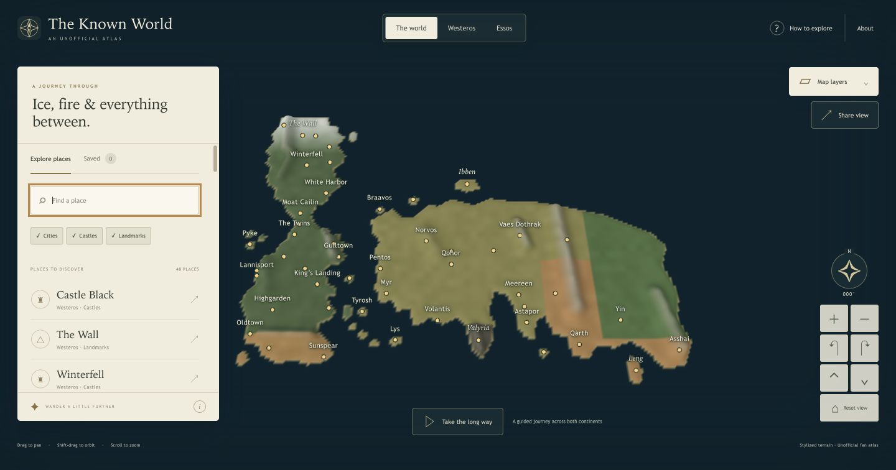

# The Known World

An unofficial 3D atlas of Westeros and Essos. Move across the Narrow Sea, find a
familiar castle, and turn toward the shape of the land.

[Open the atlas](https://known-world-alvaro.vercel.app) ·
[Personal source repository](https://github.com/alvarovillalbaa/known-world)

Native WebGL renders an actual perspective height mesh with lighting, depth and
selectable places. The cartography and procedural relief are original,
stylized interpretations, with **48 curated places** across both continents.
Coordinates are approximate atlas units. Read the [source brief](docs/spec.md)
and [cartography provenance](docs/attribution.md).

## Explore

- Drag to pan; shift-drag/right-drag to orbit and tilt; scroll to zoom. On touch
  screens, drag with one finger and pinch/twist with two. Explicit buttons offer
  zoom, orbit, tilt, north-up and continent viewpoints.
- Focus the map for keyboard navigation: arrows move, +/- zoom, Q/E orbit,
  W/S tilt, Home resets the view. Search remains ordinary text input.
- Search cities, castles and landmarks, filter place types, select a map marker
  or list result, and fly to its geographic position. Details link to references.
- Keep favorite places on this browser/device. Shared links retain the camera,
  selected place and terrain/label layers, without sharing your saved list.
- Take a guided journey across both continents, or explore at your own pace.
  Manual interaction and leaving the tab stop the journey. Reduced motion uses
  immediate transitions and disables automatic journeys.

There are no accounts, analytics, external map tiles, runtime dependencies or
paid API services. The map and its metadata ship with the app. Browser graphics
failure retains the textual catalog. Saved places stay on this device; clearing
browser data removes them. Storage failure keeps changes available for the visit.

## Local development

Use Node.js 24. No package installation or application build is needed.

```sh
npm run check
npm test
```

After browser/dev-server authorization, `npm run dev` serves `public/` at
`http://127.0.0.1:3230`; `PORT` changes the port. A filesystem URL does not provide
the HTTP module loading expected by the app. Vercel runs the same source checker
and serves `public/` using [vercel.json](vercel.json); its install command only
reports the Node version.

## Ownership and proof

[The module contract](docs/module-contract.md) separates geographic data,
camera/URL/bookmark validation, pure geometry, the WebGL viewer and the atlas UI.
`public/src/world.js` owns the original geometry and catalog. The software license
is [MIT](LICENSE); fictional setting/place names retain their creator association
as explained in [attribution](docs/attribution.md).

The [initial delivery receipt](docs/results/2026/10-28/initial-delivery.md)
records **101 passing focused frontend checks**, source provenance and exact
hosted delivery. The approved [live Chrome checks](docs/results/2026/10-28/browser-checks.md)
also exercised actual WebGL rendering, desktop navigation and marker picking,
search/filters, bookmark reload/removal, shared-view restoration and narrow
layouts at 390×844 and 390×568. They exposed and closed an ocean-fog seam and
missing accessible names on compact controls.

Those narrow checks used desktop Chrome viewport overrides. Native phone touch,
graphics-context recovery, reduced-motion behavior, exact OS clipboard contents
and clean anonymous access remain unverified. Authored lifecycle checks retain
their separate proof boundary. The wider all-project goal remains active.


